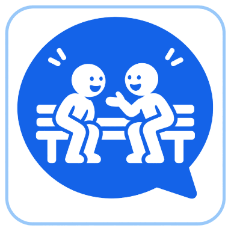

# BackPost

BackPost is an Android messenger for people nearby. Pair two phones to exchange messages and files over a direct connection using Bluetooth or Wi-Fi. The exchange works without mobile data or an internet connection between the phones.

## Download for Android

**[Download BackPost 1.0.0 for Android](https://github.com/dushyantgadewal-askdushyant/BackPost-Offline-Messaging/releases/download/v1.0.0/BackPost-Android-1.0.0%2B15-release.apk)** · Build 15 · 69.7 MB

See [installation and first chat](docs/GETTING_STARTED.md) for setup and [release notes](docs/RELEASE_NOTES.md) for the SHA-256 checksum.

BackPost is free to download and use, including at work. See [BackPost licensing](LICENSE.md) for the app, documentation, and branding terms.

## What you can do

- **Start a chat nearby.** Show your phone’s pairing QR, scan the other phone, or use **Find nearby** and compare the pairing code.
- **Pick up where you left off.** Open a previous conversation by reconnecting to the same verified device. The device fingerprint identifies it even if its display name changes.
- **Send messages and files.** Follow message status and transfer progress in the conversation. Incoming files larger than 50 MB require the recipient’s approval.
- **Choose what your phone keeps and shows.** Set chat history retention, mute individual conversations, manage notifications, and review paired-device details.
- **Check the direct connection.** The conversation shows Wi-Fi or Bluetooth when BackPost can identify the active transport.

## Screenshots

| Active conversation | Chat History |
| :---: | :---: |
|  |  |

See the [screenshot gallery](assets/screenshots/README.md) for the full set.

## Help and privacy

- [Install and start a chat](docs/GETTING_STARTED.md)
- [Messaging, transfers, and device settings](docs/USING_BACKPOST.md)
- [Troubleshooting](docs/TROUBLESHOOTING.md)
- [Privacy and nearby permissions](docs/PRIVACY.md)
- [Release notes and checksum](docs/RELEASE_NOTES.md)

## The story behind BackPost

BackPost takes its name from a place at National Institute of Technology (NIT) Rourkela where I spent time with friends during my Computer Science and Engineering days, before graduating in 2006. We’d sit together, talk about whatever was on our minds, and pass around notes.

Those moments inspired BackPost. When the person you want to talk to is nearby, starting a conversation or sharing a file should feel as simple as passing a note across the bench.

**Dushyant Gadewal · #AskDushyant**
